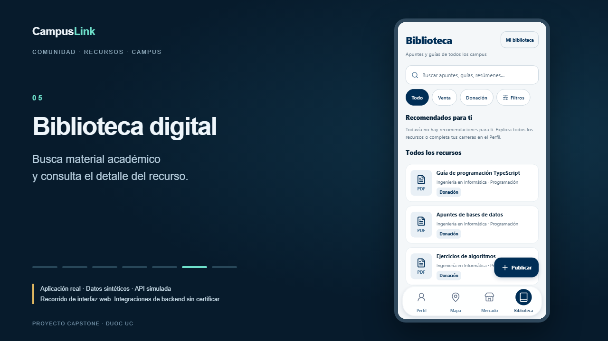

# Demostración audiovisual de CampusLink

[](campuslink-demo.mp4)

[`campuslink-demo.mp4`](campuslink-demo.mp4) contiene capturas de la aplicación real de Expo Web, recorrida con Playwright. Se presenta en un viewport de 390×783 dentro de una composición horizontal de 1280×720. Los títulos, transiciones y cursor son parte del presentador externo `demo/composition.html`; no se sustituyen pantallas de la aplicación. No hay audio, música ni servicios de video externos.

**Alcance transparente:** los datos y respuestas de API son sintéticos, incluidos sesión, identidad, actividades, recursos y vista previa. Se reutilizan las fixtures de transporte E2E, no los tests. El aviso permanece visible en todos los capítulos. No demuestra disponibilidad del backend real ni la persistencia en bases de datos. No se incluyen mapa 3D, publicaciones efectivas, solicitudes completas ni administración privilegiada.

## Regenerar con un comando

Preparación desde `frontendclink/`:

```bash
npm ci
npx playwright install chromium
node node_modules/ffmpeg-static/install.js
```

Después:

```bash
npm run demo:record
```

En PowerShell usar `npm.cmd` y `npx.cmd` si la política bloquea scripts `.ps1`. El comando inicia Expo con variables aisladas, realiza el recorrido visual, graba WebM, lo convierte a MP4 y comprueba toda su decodificación. Detiene el servidor que inició. Con `E2E_BASE_URL` usa el servidor externo preparado con los valores de `qa/environment.ts`; no lo detiene. La demo rechaza `E2E_MODE=real` para evitar grabar sesiones reales.

Las aserciones esperan el estado visible antes de continuar. Las pausas intencionales de `demo/scenarios/campuslink.ts` permiten leer los capítulos. La grabación actual dura aproximadamente 69 segundos. El proceso valida un rango de 60–120 segundos y un máximo de 20 MiB; `metadata.json` registra los valores de cada exportación. La reproducción no necesita las dependencias de desarrollo.

## Exportación local

```bash
npm run demo:record -- --capture-only
npm run demo:build
```

Los WebM, logs y datos temporales quedan en `frontendclink/demo/.artifacts/`, ignorados por Git. Solo se versionan el MP4 final, la miniatura y metadatos sin rutas personales. `demo:build` necesita `recording.json` y su WebM local; si no existen, volver a grabar. No puede reconstruirse desde el MP4 final.

FFmpeg usa `libx264`, CRF 25, preset medium, 30 fps, `yuv420p`, escalado conservando proporciones, padding, SAR 1:1 y `+faststart`. La salida es silenciosa. El binario se obtiene de `ffmpeg-static` o de `FFMPEG_PATH`. No se incorpora a Git. Si se desea reducir más el tamaño, aumentar CRF en `demo/scripts/build.ts` y volver a exportar/revisar. El script valida duración, códec, resolución, peso y una decodificación completa; la inspección visual sigue siendo necesaria tras cambiar el recorrido.

Miniatura: screenshot PNG real de la composición mostrando Biblioteca. No se utiliza una captura de pantalla inventada ni una ilustración que represente una funcionalidad ausente. Revisar fotogramas de inicio, cambios de módulo y cierre antes de publicar.

## GitHub y reproducción

Los README principal de `main` y de CampusLink en la rama experimental incluyen el **reproductor de GitHub**, mediante el MP4 subido como adjunto del repositorio:

https://github.com/user-attachments/assets/45af7840-2831-409b-a8d4-a07bfb0beadb

La URL debe permanecer sola en un párrafo para que GitHub la convierta en reproductor. Se conserva un enlace al archivo del repositorio como alternativa. Un enlace relativo o un tag `<video>` con ruta local no proporciona el mismo resultado; la evidencia inicial de sanitización sigue en `docs/qa/results/github-markdown.html`.

`npm run demo:record` regenera los archivos locales, pero no cambia este adjunto alojado en GitHub. Para publicar una versión nueva:

1. Revisar el MP4 final y su aviso de datos sintéticos.
2. En GitHub, arrastrar el MP4 al editor compatible de adjuntos de un borrador de issue/comentario, sin enviar el mensaje. GitHub sube el archivo inmediatamente y devuelve una URL real. También existe subida de adjuntos en GitHub CLI; esta publicación utilizó el mismo endpoint de assets de su implementación oficial, sin crear issues ni comentarios.
3. Copiar la URL real a un párrafo independiente de cada README y comprobar que GitHub devuelve un reproductor. Conservar el enlace al MP4 del repositorio como alternativa.
4. Mantener el archivo y la URL anterior hasta verificar la nueva publicación. No inventar URLs `user-attachments` ni afirmar que se ha alojado un asset antes de completar la subida.

GitHub documenta MP4/MOV/WebM y recomienda H.264; el límite de video adjunto del plan gratuito es 10 MB. El archivo de esta entrega es menor que ese límite. [Documentación de adjuntos de GitHub](https://docs.github.com/en/get-started/writing-on-github/working-with-advanced-formatting/attaching-files).

Cobertura funcional y preparación del backend QA: [Playwright](../qa/playwright.md).
