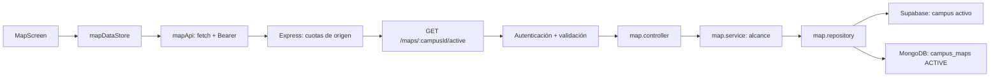

# Revisión técnica de CampusLink

**Fecha:** 8 de noviembre de 2026, America/Santiago.
**Rama:** `JP_comments`.
**Base revisada:** `8fa68c1c29fc2b86102924822a12a5009981dc15`.
**Aplicación:** `Fase 2/Evidencias Proyecto/CampusLink/`.

Las rutas de código mencionadas a continuación son relativas a esa aplicación,
salvo que se indique otra raíz. La evaluación describe el código de esta rama y
las comprobaciones realizadas en esta sesión. Los documentos y resultados de
sesiones anteriores son antecedentes, no pruebas ejecutadas nuevamente aquí.

## A. Resumen general

Se revisaron el estado Git, los manifiestos, las capas del backend, las funciones
del frontend y la reorganización conservada en Git. Se agregaron comentarios
didácticos en español a **125 fuentes: 73 del backend y 52 del frontend**, con
responsabilidades de archivo, contratos, decisiones, cancelación, concurrencia,
validación, errores y colaboración entre capas. Se conservaron y complementaron
los comentarios previos; no se añadieron funciones ni se reorganizaron carpetas.

La documentación recorre todos los módulos funcionales mediante sus puntos de
entrada y operaciones principales. Es un alcance comprobable de archivos
modificados, no una afirmación de que cada símbolo del repositorio tenga JSDoc.
El inventario actual contiene 204 fuentes TypeScript en `backendclink/src`,
306 TS/TSX en `frontendclink/src` y 24 en `frontendclink/app`. Estilos, contratos
ya explicados, recursos generados y migraciones históricas no se comentaron de
forma masiva para aumentar el historial.

Se crearon además la [guía de recorrido](GUIA_DOCUMENTACION_CAMPUSLINK.md), la
[guía de entorno y verificación](ENTORNO_Y_VERIFICACION_CAMPUSLINK.md) y este
informe. El trabajo se registró progresivamente por responsabilidad y caso de uso,
mediante commits locales con Conventional Commits.

El código y los tipos de los 125 archivos fuente cambiados conservan los mismos tokens
al excluir comentarios y espacios. También se comparó su emisión TypeScript sin
comentarios con la base y fue idéntica. Pasan los typechecks, el build backend,
las suites locales y el comprobador de arquitectura. La exportación web de Expo
terminó correctamente. No se verificó un despliegue completo con proveedores
reales ni el runtime de la imagen Docker.

El árbol inicial estaba limpio. No se cambiaron `.env`, configuración, manifiestos,
locks, migraciones, credenciales ni ramas principales. No se hizo push ni merge.
Se detectaron problemas previos y se analizaron sin introducir correcciones de
lógica ajenas a esta tarea; el principal es la contradicción de Redis opcional
en desarrollo frente a una sonda obligatoria de arranque.

## B. Historial de commits

<!-- HISTORIAL_INICIO -->
**Total actualizado: 68 commits nuevos**, contados desde la base; los 67 primeros
figuran con hash real y el último es este registro de cierre. Todos corresponden
a cambios no vacíos. Los mensajes de la tabla resumen el cambio de cada bloque.

| Orden | Commit | Cambio documentado | Alcance |
| --- | --- | --- | --- |
| 1 | `bc75a3f` | docs(architecture): registra estructura y recorrido inicial de CampusLink | 1 archivo |
| 2 | `215c908` | docs(backend): explica arranque workers y cierre ordenado | 2 archivos |
| 3 | `5a0bbbd` | docs(http): detalla ensamblaje de Express y rutas versionadas | 2 archivos |
| 4 | `d24595d` | docs(database): aclara pool MongoDB y sus límites de conexión | 1 archivo |
| 5 | `abd2ab9` | docs(database): explica clientes Supabase y aislamiento de sesiones | 1 archivo |
| 6 | `4db92e5` | docs(database): documenta transacciones PostgreSQL y liberación del pool | 1 archivo |
| 7 | `6b7e4aa` | docs(database): detalla contador Redis y reconexión de cuotas | 1 archivo |
| 8 | `f4307b5` | docs(health): distingue disponibilidad de dependencias y módulos | 3 archivos |
| 9 | `f41fd1a` | docs(http): explica contratos de respuesta y sanitización de errores | 2 archivos |
| 10 | `7fac00c` | docs(security): documenta políticas explícitas y validación HTTP | 2 archivos |
| 11 | `a3c04a3` | docs(security): explica cuotas por origen identidad y memoria | 2 archivos |
| 12 | `15315dc` | docs(auth): explica rutas públicas contexto verificado y controladores | 3 archivos |
| 13 | `1cbef8e` | docs(auth): documenta provisión institucional y persistencia de identidad | 2 archivos |
| 14 | `1178c3e` | docs(auth): aclara capacidades por campus y propiedad de recursos | 2 archivos |
| 15 | `086e2e5` | docs(users): explica edición académica y resumen personal | 3 archivos |
| 16 | `0ccaf4b` | docs(users): detalla alcance administrativo y versiones de acceso | 1 archivo |
| 17 | `f8a815a` | docs(audit): explica mezcla cronológica de historiales SQL y Mongo | 1 archivo |
| 18 | `f894755` | docs(notifications): documenta operaciones propias y revalidación de cuenta | 1 archivo |
| 19 | `83afb99` | docs(maps): explica mapa activo autorización y persistencia híbrida | 3 archivos |
| 20 | `02ffb0a` | docs(activities): explica consultas visibles y rutas de actividades | 2 archivos |
| 21 | `db5fc01` | docs(activities): documenta publicación atómica y cupo comunitario | 2 archivos |
| 22 | `8839166` | docs(activities): explica vista previa y revalidación transaccional de edición | 2 archivos |
| 23 | `e46c496` | docs(activities): explica participación propia e idempotencia de interacciones | 3 archivos |
| 24 | `1c17651` | docs(activities): detalla recurrencia calendario y horarios ambiguos | 1 archivo |
| 25 | `2f8b0b1` | docs(workers): explica entrega diferida y cierre de mantenimiento de actividades | 1 archivo |
| 26 | `762c564` | docs(physicalgoods): explica publicación SQL y compensación en Storage | 1 archivo |
| 27 | `c1fbf48` | docs(physicalgoods): documenta solicitudes acuerdos y doble confirmación | 2 archivos |
| 28 | `3b4bf07` | docs(physicalgoods): explica galería privada y worker de recordatorios | 2 archivos |
| 29 | `93b3160` | docs(elibrary): explica publicación digital y contexto institucional | 1 archivo |
| 30 | `fac4e95` | docs(elibrary): documenta multipart archivos privados y muestra PDF | 3 archivos |
| 31 | `939f855` | docs(elibrary): explica acuerdos digitales y biblioteca adquirida | 2 archivos |
| 32 | `273fc60` | docs(recommendations): explica puntuación digital y señales verificables | 2 archivos |
| 33 | `5a410db` | docs(reports): explica denuncias y revisión de evidencia por campus | 2 archivos |
| 34 | `24d35b8` | docs(reports): detalla resolución recuperable entre SQL y MongoDB | 1 archivo |
| 35 | `8027362` | docs(analytics): explica métricas períodos y snapshots guardados | 1 archivo |
| 36 | `76b8c19` | docs(analytics): documenta exportación fiel de reportes PDF y Excel | 2 archivos |
| 37 | `4f17740` | docs(navigation): explica providers guards y redirección inicial | 2 archivos |
| 38 | `93fedf1` | docs(auth-ui): explica restauración de sesión y revalidación de identidad | 2 archivos |
| 39 | `4ca7da5` | docs(auth-ui): documenta formularios de acceso registro y recuperación | 3 archivos |
| 40 | `a066623` | docs(api-client): detalla transporte autenticado sobres y errores acotados | 1 archivo |
| 41 | `a09f1f9` | docs(profile-ui): explica caché de ámbito y edición académica versionada | 2 archivos |
| 42 | `eabf695` | docs(admin-ui): documenta contexto cancelación y filtros de accesos y auditoría | 2 archivos |
| 43 | `63cabf4` | docs(notifications-ui): explica foco paginación y confirmación de lecturas | 1 archivo |
| 44 | `05a2098` | docs(map-ui): explica carga remota y limpieza del ámbito del mapa | 2 archivos |
| 45 | `9288622` | docs(map-ui): documenta frontera web y recuperación de WebGL | 2 archivos |
| 46 | `fb548f8` | docs(map-api): aclara adaptación espacial y contrato con la cámara | 2 archivos |
| 47 | `766c02d` | docs(activities-ui): explica ámbito de consultas y revalidación por vencimiento | 1 archivo |
| 48 | `ebfe404` | docs(activities-ui): documenta ficha participación e intención idempotente | 1 archivo |
| 49 | `cd2a15e` | docs(activities-ui): explica publicación recurrente y edición con preview | 2 archivos |
| 50 | `1618733` | docs(marketplace-ui): explica catálogo físico y renovación de imágenes firmadas | 1 archivo |
| 51 | `9b86e90` | docs(marketplace-ui): documenta publicación física y cola de fotos pendientes | 1 archivo |
| 52 | `3ee3d63` | docs(marketplace-ui): explica solicitud idempotente y conciliación de acuerdos | 3 archivos |
| 53 | `b0f98da` | docs(elibrary-ui): explica estado del catálogo y recomendaciones digitales | 2 archivos |
| 54 | `d56adb4` | docs(elibrary-ui): documenta selección PDF multipart y validación local | 2 archivos |
| 55 | `4a8fb9a` | docs(elibrary-ui): explica acuerdos preview y descarga multiplataforma | 3 archivos |
| 56 | `abe9e4e` | docs(reports-ui): explica denuncia propia y resolución administrativa | 2 archivos |
| 57 | `ba7f092` | docs(analytics-ui): documenta consulta generación histórica y exportación | 3 archivos |
| 58 | `dcd5176` | docs(ui): explica refresco compartido y safe area por plataforma | 2 archivos |
| 59 | `50adcfd` | docs(validation): explica moderación del servidor y validación temprana del cliente | 2 archivos |
| 60 | `daea484` | docs(pagination): explica parsers seguros y lectura de una fila adicional | 1 archivo |
| 61 | `4705b35` | docs(routes): completa mapa de endpoints y diferencias de transporte | 6 archivos |
| 62 | `ec8ff79` | docs(api-ui): explica contratos de sesión perfil denuncias y analítica | 4 archivos |
| 63 | `aa62b05` | docs(components): documenta composición visual y reutilización accesible | 5 archivos |
| 64 | `f9c5bd5` | docs(files): precisa inspección PDF y límites de la extracción aislada | 2 archivos |
| 65 | `9a1a17b` | docs(infra): explica entorno Docker y límites de verificación | 1 archivo |
| 66 | `43c8dd5` | docs(review): incorpora evaluación técnica arquitectura y guía de estudio | 1 archivo |
| 67 | `31c3026` | docs(history): registra los 67 commits y el cierre de la revisión | Historial completo y comprobaciones finales de la revisión inicial. |
| 68 | Este commit (autorreferencia) | `docs(comments): convierte etiquetas JSDoc en texto explicativo` | Convierte 51 etiquetas en 35 fuentes y actualiza este registro. |

El hash de un commit depende de su contenido: incluir aquí su propio hash completo
produciría una referencia circular. El último se identifica por su mensaje exacto;
los hashes de los 67 anteriores sí están fijados. Para obtener el identificador del
cierre sin depender de que HEAD conserve esa posición:

```powershell
git log JP_comments --format="%h %s" --fixed-strings --grep="docs(comments): convierte etiquetas JSDoc en texto explicativo"
```

Para estudiar un bloque, usar `git show <hash>`; los commits agrupan cambios reales
de responsabilidad o caso de uso. No se alteraron fechas ni autores anteriores,
no se hicieron commits vacíos, squash, push ni merge.
<!-- HISTORIAL_FIN -->

## C. Arquitectura actual y evolución de carpetas

### C.1. Estructura vigente

```text
Capstone/
  docs/                              # Material de esta revisión
  .github/workflows/android-apk.yml   # Workflow manual de builds móviles
  Fase 1/, Fase 2/                    # Entregables académicos
  Fase 2/Evidencias Proyecto/CampusLink/
    backendclink/
      src/
        server.ts                    # Entorno, señales y workers
        bootstrap.ts                 # Conectar, comprobar, escuchar y cerrar
        app.ts                       # Ensamblaje Express
        readiness.ts                 # Composición de salud de arranque
        config/                      # Entorno y adaptador histórico Mongo
        routes/index.ts              # /api/v1 y routers funcionales
        database/
          mongodb/                   # Cliente, salud y migraciones documentales
          supabase/                  # SDK, pool pg, salud y migraciones SQL
          redis/                     # Cliente y cuotas distribuidas
        modules/
          auth/                      # Identidad, sesión y autorización común
          users/                     # Perfil, acceso, auditoría y notificaciones
          maps/                      # Mapa activo y referencias espaciales
          activities/                # Actividades, series y participación
          marketplace/
            domain/, repositories/   # Mensajes, avisos y valoración comunes
            physicalgoods/           # Recursos físicos y entrega declarada
            elibrary/                # PDF, biblioteca y acuerdos digitales
          reports/                   # Denuncias y moderación administrativa
          analytics/                 # Métricas, snapshots y exportación
        shared/
          http/, errors/             # Sobres, validadores y políticas HTTP
          health/, async/            # Sondas, caché y deadlines
          pagination/, rate-limit/   # Contratos comunes
          moderation/                # Reglas de texto público
      tests/, qa/, scripts/          # Pruebas, fixtures y revisión de imports
      Dockerfile, docker-compose.yml
    frontendclink/
      app/                           # Expo Router: rutas y layouts
      src/
        features/
          auth/, users/, activities/, reports/, analytics/
          marketplace/
            components/, hooks/, api/ # Colaboración común de marketplace
            physicalgoods/, elibrary/
        components/                  # Scroll, paginación, skeleton y navegación
        lib/                         # Transporte, archivos, validación y layout
        three/                       # API espacial, escena, cámara y stores
        types/                       # Tipos/constantes transversales
        hooks/, store/               # Andamiaje residual con .gitkeep
      assets/                        # Modelo GLB, imágenes y otros recursos
      tests/, scripts/               # Contratos, renderizado y herramientas
```

En backend cada módulo conserva `*.routes.ts` en su raíz y usa solo las carpetas
que necesita: `controllers`, `services`, `repositories`, `types`, `domain`,
`validators`, `middleware`, `workers`, `files` o `exports`. No todos tienen todas
las carpetas. Los modelos son interfaces/DTO/documentos, no clases ORM.
En frontend la unidad funcional es `features/<módulo>/{api,components,hooks,types}`;
existen también utilidades de dominio cuando la funcionalidad lo necesita.

### C.2. Reconstrucción histórica comprobable

Se contrastaron árboles y detección de renombres de Git, además de
`backendclink/ARCHITECTURE.md`, `REFACTOR.md`, `REFACTOR_FILES.md` y
`frontendclink/src/features/README.md`.

| Evidencia Git | Qué permite afirmar |
| --- | --- |
| `8eceb05` | Snapshot previo al refactor modular del backend, con archivos de cada módulo concentrados en su raíz. |
| `7d86cb1` a `af8d613` | Separación por capas, infraestructura compartida, operaciones públicas y eliminación del ciclo de planificación de edición. |
| `43b5106` y su padre | Reorganización de auth/users frontend y extracción de estado desde pantallas hacia hooks. |
| `8b54f90` | Importación mediante subtree a `Fase 2/Evidencias Proyecto/CampusLink`, conservando historia del desarrollo. |
| `479fcb0` | Integración histórica de esa importación en el repositorio académico. |
| `8fa68c1` | Base efectiva de la rama de esta tarea, posterior a cambios móviles y de despliegue. |

En `git diff -M 8eceb05 af8d613 -- backendclink/src`, Git detecta **145 renombres**,
18 modificaciones, 26 altas y 5 bajas. Son categorías de ese diff y su heurística
de similitud: una baja en el refactor no demuestra que se eliminara una función
del producto. Las consolidaciones deben leerse junto con sus destinos.

Ejemplos de cambios reconstruidos; el prefijo del subtree se agrega al llegar a
la ubicación actual:

| Antes del refactor | Después / ubicación relativa actual |
| --- | --- |
| `backendclink/src/database/rate-limit.redis.ts` | `database/redis/rate-limit.redis.ts` dentro de `src`. |
| `modules/auth/auth.controller.ts` | `modules/auth/controllers/auth.controller.ts`. |
| `modules/activities/activities.create.service.ts` | `modules/activities/services/activities.create.service.ts`. |
| `modules/activities/activities.edit.repository.ts` | `modules/activities/repositories/activities.edit.repository.ts`. |
| `modules/activities/activities.recurrence.ts` | `modules/activities/domain/activities.recurrence.ts`. |
| `frontendclink/src/features/auth/supabase.ts` | `features/auth/api/supabaseClient.ts` dentro de `src`. |
| `features/auth/session.ts` | `features/auth/api/sessionApi.ts`. |
| `features/auth/AuthProvider.tsx` | Estado movido a `hooks/useAuthSession.ts`, con provider separado en `components`. |
| `features/users/profile.ts` | `features/users/api/profileApi.ts`. |
| `features/users/AcademicProfile.tsx` | Presentación en `components/AcademicProfile.tsx` y estado extraído a `hooks/useAcademicProfile.ts`. |
| `features/users/audit.ts` | `features/users/types/audit.ts`. |

Los paths backend de la tabla se interpretan desde `backendclink/src`; los frontend,
desde `frontendclink/src`, excepto cuando se escribe su prefijo completo.
La historia permite asegurar esos snapshots y movimientos; no reconstruye cambios
locales nunca registrados ni se presenta como inventario de todos los estados
intermedios. El traslado al repositorio académico no fue una reorganización nueva
realizada durante esta revisión.

### C.3. Responsabilidades y dependencias

| Capa | Responsabilidad | Dependencias esperadas |
| --- | --- | --- |
| Ruta backend | Método/path, política y orden de middleware. | Controladores, validadores, auth. |
| Controlador | Adaptar HTTP y producir sobre/estado/binario. | Servicios y datos en `response.locals`. |
| Servicio | Caso de uso, autorización, coordinación y DTO. | Repositorios, dominio y capacidades públicas ajenas. |
| Repositorio | Consultas SQL/Mongo, Storage y clientes externos. | Drivers compartidos y contratos; sin Express. |
| Dominio | Políticas/transformaciones reutilizables. | Tipos y utilidades; no debe conocer persistencia operativa. |
| `public.ts` | Exportación explícita de operaciones entre módulos. | Implementación del módulo propietario. |
| Ruta/layout Expo | Navegación, provider y composición de pantalla. | Componentes y capacidades del contexto. |
| Componente React | Presentación y callbacks; algunos formularios aún coordinan I/O. | Hooks, props y tipos. |
| Hook | Estado, efectos, cancelación, intención y carga. | APIs del feature y sesión compartida. |
| API frontend | Construir HTTP y adaptar respuestas/errores. | Transporte común y contratos. |
| Three | Geometría, cámara, selección y metadata espacial. | API de mapas, GLB y Zustand. |

La nueva organización hace más fácil localizar un caso de uso, probar sus
dependencias y revisar cambios de persistencia sin entrar a la UI. Las operaciones
públicas pueden recibir el mismo `PoolClient` del llamante: eso conserva una
transacción SQL, sin abrir otra por atravesar la frontera modular.

La separación es buena como monolito modular, aunque no es independencia absoluta.
`users/services/profile-overview.service.ts` reutiliza la frontera del historial
físico; usuarios/auditoría conocen capacidades de actividades y marketplace;
reports coordina varios módulos. `shared/http/endpoint-policy.ts` depende
intencionalmente de auth para imponer política por defecto. El grafo de archivos
revisado no contiene ciclos runtime; agregar nombres de módulos a un diagrama
puede formar relaciones en ambos sentidos sin contradecir ese resultado.

### C.4. Duplicados, compatibilidad y residuos

No se encontraron archivos **idénticos byte por byte de más de 80 bytes** entre los
TS/TSX de los dos `src`. Esa comparación no detecta duplicación parcial o semántica.
Se repiten patrones de hooks —cancelación, estado, mensajes y conciliación— que
merecen evaluación antes de extraer abstracciones comunes.

Los dos `three/.../CampusModel.tsx` tienen responsabilidades distintas:
`models` carga/cachea el GLB; `components` compone pisos y decoración. El archivo
`three/data/floors.ts` conserva metadata local histórica; no se encontró un import
TS/TSX activo hacia él. Es deuda de claridad, no una segunda fuente activa del mapa.
Las parejas `.tsx`/`.web.tsx` son variantes por plataforma, no copias accidentales.

`config/mongodb.ts` y los tres adaptadores históricos
`activities.{types,interactions,participation}.ts` conservan imports de la migración
005. Reexportan una implementación, no deben confundirse con repositorios nuevos.
Los `.gitkeep` vacíos tampoco significan que exista una funcionalidad implementada.

## D. Funcionamiento del sistema

### D.1. Inicio del backend

1. `server.ts` carga dotenv y usa imports dinámicos para que fallos de configuración
   lleguen a un mensaje de arranque acotado.
2. `bootstrap.ts` conecta MongoDB y Redis. PostgreSQL crea su pool bajo demanda.
3. La verificación agrega dependencias y diagnósticos de módulos; reintenta hasta
   tres veces, esperando más que el TTL para no reutilizar un fallo cacheado.
4. Solo después se abre el puerto. A continuación `server.ts` inicia los workers
   de notificaciones de actividades y recordatorios físicos.
5. SIGINT/SIGTERM drenan HTTP y workers y liberan pools. El proceso impone un
   plazo global de 29 segundos; repetir la señal no duplica el cierre.

Crear `app` no abre conexiones ni escucha. En cambio, importar `env` sí valida
la configuración: separar composición de arranque no elimina ese requisito.

### D.2. Inicio del frontend

Expo Router entra por `app/_layout.tsx`. `AuthProvider` ejecuta `useAuthSession`,
escucha eventos del SDK, restaura sesión y consulta `/api/v1/auth/me` para obtener
perfil, roles, permisos y capacidades vigentes. Tener un token local no basta
para el estado `ready`. El layout ofrece rutas según ese estado y capacidades.

La persistencia nativa del SDK usa AsyncStorage; las animaciones/cámara usan refs
y los stores Zustand conservan selección y documento espacial. No existe un único
store global que contenga todo el negocio: muchos hooks usan estado React local.
Los guards de navegación ayudan a la experiencia; la autorización reside en API.

### D.3. Petición de mapa activo



El cliente recibe token por parámetro, rechaza redirecciones y adapta el sobre a
índices de edificios/pisos. El servicio exige el campus vigente del perfil,
capacidad general y un documento ACTIVE del mismo campus. El repositorio usa UUID
relacional como referencia en MongoDB; no existe foreign key entre esos motores.
El GLB se carga localmente y sus nombres de nodos se unen con `meshName/subMeshes`.
CameraController hace raycast sobre mallas `isFloor`; el store comunica selección
a cámara, escena y modal sin provocar renders React en cada frame.

### D.4. Actividades: lectura, alta, participación y edición

`useLocationActivities → activitiesApi → activities.routes → requireAuthentication
→ validateRequest → activities.controller → activities.service → repositorios`.
Antes del DTO se comprueban mapa, ubicación, visibilidad y creador vigente.

Al publicar, el endpoint elige tipo comunitario/oficial; el cuerpo no lo decide.
El servicio valida fechas, contenido y capacidad. `insertActivity` confirma en una
transacción Mongo actividad, participación inicial del creador e interacción JOINED.
Para el cupo comunitario usa una escritura compartida de revisión del mapa: evita
que dos snapshots concurrentes aprueben el mismo cupo antes de insertar IDs distintos.

Inscribirse devuelve la ficha releída del servidor. El retiro propio y la consulta
de participación siguen disponibles aunque la ficha visible dé 404, con las reglas
correspondientes. Un `operationId` conserva la misma intención ante un reintento;
una intención nueva requiere otra clave. No toda petición GET registra una vista:
las aperturas explícitas tienen su endpoint de interacción.

La edición primero construye previewHash con contenido/revisión. Al guardar,
el repositorio recibe el planificador y lo repite con lectores de su sesión Mongo.
Guarda before/after y avisos junto al cambio. Una revisión distinta produce 409.
La recurrencia usa Temporal y zona IANA, con máximo 200 ocurrencias y dos años;
rechaza horas ambiguas/inexistentes en vez de elegir silenciosamente una.

### D.5. Publicación y acuerdo de un recurso físico

`usePublishPhysicalgoods → physicalgoodsApi → ruta autenticada → JSON acotado
→ controlador → createPhysicalgoods → Storage + repositorio SQL`.
La imagen principal viaja en JSON/base64; no usa el multipart digital.
Storage recibe los bytes antes de abrir locks SQL. Luego se revalidan perfil,
campus y catálogos y se guardan publicación, referencia y auditoría en SQL.
Ante fallo se comprueba si el objeto tiene referencia antes de compensar: perder
la respuesta de COMMIT no significa necesariamente que la transacción falló.

La galería ofrece URLs firmadas por 60 segundos, después de comprobar bucket,
campus y referencia. El frontend las renueva y conserva la clave de apertura para
no duplicar vistas. Solicitar un recurso no lo reserva; aceptar la solicitud crea
el acuerdo correspondiente. Completar exige confirmaciones de propietario y
receptor. La valoración del propietario es posterior y tiene reglas propias.
La aplicación no procesa el pago ni certifica físicamente la entrega.

### D.6. Biblioteca digital y descarga

`useDigitalLibrary → elibraryApi → ruta autenticada → controlador/Busboy
→ servicio → validación PDF → Storage + SQL`.
Busboy limita archivo/partes/metadatos; el archivo tiene máximo 25 MiB.
El validador revisa nombre, MIME, cabecera/cierre, cifrado, objetos, acciones,
adjuntos y enlaces; no visita los destinos. El alta y las asociaciones académicas
se confirman en SQL tras la carga. Las colas frontend conservan adjuntos pendientes
si una publicación se confirma parcialmente.

La muestra no es el original: un worker pdfjs extrae un fragmento de la primera
página, con límites de concurrencia/tiempo/heap y sin OCR. Un original exige
propietario o adquisición completada; se autorizan cuenta y referencia antes y
después de Storage. `saveFile` recibe bytes ya autorizados, espera la escritura
nativa y luego comparte; en web genera una descarga blob temporal.

Las recomendaciones sí están implementadas. El servicio usa pesos de carrera 30,
asignatura 20, vista propia 5, solicitud propia 10 y actividad 1. SQL limita las
coincidencias académicas a tres por tipo y la actividad a cinco, excluye material
propio/adquirido/no visible y desempata por fecha e ID. Es un ranking de reglas;
no un modelo entrenado ni una probabilidad de relevancia.

### D.7. Denuncias, auditoría, notificaciones y analítica

Reports guarda evidencia del contenido observado, no una copia de toda la entidad
privada. Revisión y resolución exigen administración vigente en el campus. Ocultar
una publicación relacional comparte transacción con decisión/auditoría. Para una
actividad se guarda primero intención durable en SQL, luego se oculta en Mongo y
se finaliza el caso. Una interrupción necesita retomar la misma decisión; no hay
rollback distribuido entre motores.

La auditoría administrativa combina filas SQL y eventos Mongo por un orden común,
conservando precisión temporal y desempate por ID. Lee lotes acotados, aunque una
página lejana aún debe recorrer registros anteriores. La bandeja propia se filtra
por usuario/campus y aplica lecturas/retiros tras su acuse.

Los avisos de actividades quedan pendientes en Mongo y un worker los entrega a
users/SQL antes del acuse. Si se pierde el acuse se reintenta: el destino necesita
idempotencia. Los workers se programan por proceso, con una tanda inicial y luego
60 segundos después de terminar la anterior; no son un servicio externo de colas.

Analytics convierte fechas civiles de America/Santiago en intervalos, consulta SQL
y Mongo, diferencia ausencia de datos de cero y explicita cobertura histórica
parcial. Generar un reporte guarda un snapshot con autor, filtros y versión de
cálculo. PDF/Excel exportan esa instantánea sin recalcularla; el permiso se vuelve
a revisar al acceder. No deben sumarse saldos de usuarios entre períodos ni
resumen y detalle como si fueran conjuntos exclusivos.

## E. Tecnologías y responsabilidad

Versiones leídas de los locks de esta rama, no inferidas del texto de los README:

| Tecnología | Versión observada | Responsabilidad |
| --- | --- | --- |
| Node.js | Backend declara 22; host 24.21.0 | Runtime HTTP, workers y herramientas. |
| TypeScript backend | 7.0.2 | Tipado estricto y compilación NodeNext. |
| Express | 5.2.1 | Rutas, middleware y propagación de rechazos async. |
| MongoDB driver | 7.6.0 | Mapas, actividades, transacciones y eventos. |
| Supabase JS backend | 2.117.1 | Auth, Data API y Storage con clientes de distinto alcance. |
| pg | 8.23.1 | Pool TLS y transacciones/bloqueos SQL. |
| redis | 5.12.1 | Cliente de cuotas; Compose usa Redis 7 Alpine. |
| Expo | 58.0.19 | Empaquetado multiplataforma y módulos nativos. |
| React / React Native | 19.3.0 / 0.88.0 | Componentes, hooks y UI nativa compartida. |
| TypeScript frontend | 6.0.3 | Tipado estricto, alias `@/*` y validación de imports. |
| Supabase JS frontend | 2.117.3 | Restaurar, persistir y renovar la sesión pública. |
| Three.js | 0.185.1 | Geometría, cámara y raycast. |
| React Three Fiber / Drei | Según lock frontend | Integración React de Canvas y carga GLTF. |
| Zustand | Según lock frontend | Metadata remota y selección del mapa. |
| NativeWind / Tailwind | Según lock frontend | Estilos y configuración Metro/Babel. |
| Temporal polyfill | Según lock backend | Recurrencias y calendario con zona IANA. |
| Busboy / pdf-lib / pdfjs-dist | Según lock backend | Multipart, inspección PDF y extracción textual. |
| ExcelJS / fontkit | Según lock backend | XLSX y fuentes embebidas en exportación. |
| Verlux + catálogo chileno | Según lock backend | Filtro de lenguaje y reglas de texto público. |
| node:test / tsx / PGlite | Según proyecto | Runner, ejecución TS y SQL aislado en pruebas. |
| Docker / Compose / GitHub Actions | Archivos del repositorio | Imagen, API+Redis local y builds móviles manuales. |

PostgreSQL es el motor relacional del proyecto Supabase; Data API y `pg` son
caminos de acceso distintos al dominio relacional. Storage guarda objetos, no
reemplaza filas/locks. Redis no es la base de recursos. MongoDB no contiene
triángulos ni materiales del GLB. No hay ORM añadido durante esta revisión.

Los imports `.js` en fuentes TS obedecen NodeNext. El backend no declara
`type: module`; el build conserva CommonJS en esta configuración. No debe
interpretarse la sintaxis import/export del fuente como migración a ESM estricto.

## F. Evaluación técnica

### F.1. Criterio de estados y evidencia

| Estado | Uso en esta evaluación |
| --- | --- |
| Implementado y verificado | Código presente y comportamiento comprobado por el check local indicado; el alcance de ese check se explicita. |
| Implementado, pero no verificado | Código/configuración presente cuya ejecución real no se comprobó aquí. |
| Parcialmente implementado | Existe una parte operativa y una limitación/contradicción comprobable. |
| Diseñado, pero todavía no implementado | Existe intención/diseño sin recorrido operativo; no basta con que aparezca en UML. |
| No implementado | No se encontró implementación del elemento evaluado en los puntos revisados. |
| No aplica | Elemento expresamente fuera del alcance actual. |

| Área / función | Estado final y alcance |
| --- | --- |
| Compilación y tipado backend/frontend | Implementado y verificado por comandos locales. |
| Imports/capas backend | Implementado y verificado: 204 fuentes, sin infracciones del comprobador. |
| Auth, autorización, perfil, actividades, marketplace, moderación y analítica | Implementado y verificado en escenarios locales de las suites; no aceptación integral contra proveedores reales. |
| RLS, migraciones y concurrencia SQL | Implementado y verificado en escenarios PGlite/dobles existentes; despliegue real no verificado. |
| Mapa/3D | Adaptación y contratos verificados; bundle web generado; render y gestos en dispositivo no verificados aquí. |
| Recomendaciones digitales | Implementado y verificado en los tests `elibrary.test.ts`; no está solo diseñado. |
| Auth/correo/OTP/Storage contra Supabase real | Implementado, pero no verificado en esta sesión. |
| Transacciones e índices con Mongo real | Implementado, pero no verificado en esta sesión. |
| Redis real compartido y caída entre instancias | Implementado, pero no verificado: dos tests condicionados quedaron omitidos. |
| Desarrollo sin URL Redis | Parcialmente implementado: memoria existe, pero la sonda impide readiness del arranque predeterminado. |
| Recuperación SQL/Mongo | Implementada como coordinación durable con reintento; no ofrece atomicidad distribuida. |
| Docker runtime / despliegue | Implementado, pero no verificado; solo validación estructural Compose. |
| Builds Android/iOS | Workflow y scripts presentes; no se ejecutaron builds nativos ni emuladores aquí. |
| Iteración futura del árbol/easter egg del mapa | Diseñada/intención señalada en comentario de CampusModelScene; el árbol se conserva como decoración sin selección de piso. |
| Lint y reporte porcentual de cobertura en scripts npm | No implementado en los manifiestos revisados; no se atribuye un porcentaje de cobertura. |
| Pagos electrónicos y GPS continuo | No aplica al alcance descrito de CampusLink. |

### F.2. Fortalezas

- Separación modular acompañada de un comprobador real de imports, capas y ciclos.
- Fábricas e interfaces de dependencia permiten probar HTTP y casos de uso sin
  proveedores reales. Las suites incluyen validación, permisos y fallos, además
  de caminos de éxito.
- Autorización por campus/propiedad y relecturas transaccionales protegen contra
  usar un contexto antiguo tras cambiar cuenta o concesiones.
- Errores centralizados, clientes con timeouts, cuotas por origen/identidad,
  CORS configurable y parsers de cargas después de autenticar.
- Versiones optimistas, locks e idempotencia explícita en operaciones sensibles.
- Referencias privadas y descargas autorizadas; las URLs firmadas se generan
  después de comprobar su pertenencia y sin sostener SQL durante transferencias.
- Hooks distinguen datos, carga, error, selección e intención; varias respuestas
  se filtran por ámbito para no presentar información de otra sesión.
- Mapa aislado en Three, variantes por plataforma y alternativa web ante WebGL
  no disponible. Exportación y formatos de archivos tienen pruebas propias.
- Analítica conserva snapshots, versión y notas de cobertura: evita presentar
  ausencia de datos como cero o recalcular un reporte histórico al exportarlo.

### F.3. Hallazgos y prioridades

| ID | Prioridad | Evidencia y consecuencia | Mejora propuesta, no ejecutada |
| --- | --- | --- | --- |
| H1 | Alta | `loadEnv`, `createRateLimits` y `database/readiness.ts` discrepan sobre Redis opcional en desarrollo. Se reprodujo connect sin URL seguido de probe fallido. | Definir una sola política y agregar un escenario de arranque que use el fallback elegido. |
| H2 | Alta operativa | No hubo proveedores reales, motor Docker ni Node 22 en la ejecución de checks. Las suites locales no certifican esos entornos. | Verificar staging con runtime declarado, migraciones, RLS, Storage privado, transacciones Mongo e integración Redis. |
| H3 | Media | README raíz dice que no hay fuente; README CampusLink menciona Expo 57/RN 0.86 y recomendaciones pendientes. Los locks/código indican Expo 58/RN 0.88 y ranking existente. `ARCHITECTURE.md` conserva explicación antigua sobre sondas PostgreSQL. | Alinear documentos de entrada con los contratos actuales, conservando evidencia histórica. Este informe deja la corrección explícita sin reescribirlos. |
| H4 | Media | SDK técnico, Data API y pg conviven; migraciones/permisos reales no se aplicaron. `SUPABASE_DB_URL` es opcional para el parser pero requerida por readiness actual. | Documentar requisitos mínimos por modo y comprobarlos en el arranque antes de operar. |
| H5 | Media | Coordinación SQL/Storage y SQL/Mongo usa compensación o intención durable. Una caída puede dejar conciliación pendiente. | Definir procedimiento observable de conciliación, métricas de pendientes y pruebas de fallo entre pasos. |
| H6 | Media | `access.service.ts`, `analytics.service.ts`, `useDigitalLibrary` y hooks de transacción reúnen varias tareas. Perfil-resumen depende del historial físico. | Separar casos y extraer una frontera de contexto compartida solo tras preservar orden de locks y contratos. |
| H7 | Media | `ActivityCard` monta `useActivityDetail` por tarjeta, además del listado; auth también relee contexto por petición. | Medir solicitudes y latencia; evaluar DTO/batch adecuado antes de cambiar consistencia o permisos. No se midió degradación aquí. |
| H8 | Media | Muchas APIs frontend convierten JSON con tipos genéricos; algunas respuestas tienen validación runtime específica, otras solo casts. Los catches de hooks no presentan errores de forma uniforme. | Validar DTO en la frontera y compartir política de error donde el dominio realmente coincida. |
| H9 | Media | El límite de 25 MiB acota bytes; la inspección `pdf-lib` de validación corre en el proceso principal, mientras solo preview usa worker. | Medir CPU/memoria de PDFs extremos y considerar aislamiento/cola para validación. No se demostró una explotación ni se certifica antivirus. |
| H10 | Media | Hay `latest` en dependencias y etiquetas de imagen flotantes, aunque se conserva lock. Dos versiones mayores de TypeScript conviven. | Actualizar de forma controlada y verificar motores; valorar fijar versiones/digests conforme a la política del proyecto. |
| H11 | Media | No hay scripts de lint/cobertura; las pruebas mezclan análisis estático, dobles y render local. | Medir cobertura por dominio y añadir integración/E2E que cubra límites no representados por los dobles. |
| H12 | Baja | Adaptadores históricos, metadata local `floors.ts` y carpetas vacías pueden confundirse con implementación vigente. | Mantener su razón de existencia cerca del código; retirar solo con análisis de consumidores/migraciones. |

No se modificaron estas decisiones de arquitectura durante una tarea de comentarios.
Las prioridades indican impacto probable y necesidad de verificación, no una lista
de incidentes de producción confirmados.

### F.4. Seguridad, mantenibilidad y escalabilidad

La API distingue identidad, cuenta activa, capacidad por campus y propiedad.
`createPolicyRouter` deniega por defecto un endpoint sin política declarada; esa
política debe ser el primer handler. `requireVerifiedIdentity` permite completar
un registro sin perfil, mientras `requireAuthentication` carga el contexto de cuenta.
Los metadatos editables de Auth no conceden roles. La recuperación no devuelve
tokens temporales al cliente normal y usa respuestas uniformes para no enumerar
cuentas mediante el resultado del envío.

Helmet, CORS y rate limiting cubren fronteras diferentes. CORS no sustituye auth,
un hash de operación no es una credencial y una URL firmada sigue siendo una
capacidad temporal de acceso al objeto. Los secretos del backend deben permanecer
fuera de `EXPO_PUBLIC_*`. Las pruebas revisan varios de estos contratos, pero no
constituyen pentest, auditoría de dependencias ni verificación de red/infraestructura.

El monolito modular facilita crecimiento sin requerir microservicios. Los procesos
pueden compartir cuotas con Redis, pero sus workers corren por instancia y la
entrega debe mantener idempotencia. Locks, pools de cinco conexiones y transacciones
reducen inconsistencias a cambio de contención que necesita medición. El acceso
SQL/Mongo secuencial no es una instantánea distribuida. El ranking con subconsultas,
las lecturas de detalle por tarjeta, el recorrido de offsets y el procesamiento PDF
son candidatos a perfilado; no se ejecutaron pruebas de carga ni EXPLAIN de producción.

## G. Verificaciones y resultados

### G.1. Comandos ejecutados

Los comandos npm/Node se ejecutaron en el subproyecto correspondiente. Se hicieron
comprobaciones iniciales antes de comentar, un typecheck intermedio del backend
y verificaciones posteriores a los bloques. La tabla recoge el resultado final,
no suma los mismos tests cada vez que se repitieron.

| Comando / comprobación | Resultado observado | Límite |
| --- | --- | --- |
| `git status --porcelain=v1`, `git branch -vv`, `git log`, reflog | Base limpia y rama nueva `JP_comments` desde `8fa68c1`. | Sin cambiar de rama ni consultar estado remoto actualizado. |
| `npm ci --offline --no-audit --no-fund` | Intentos iniciales fallidos por paquetes ausentes en caché. | No es un fallo de la aplicación. Se retiró la caché temporal creada para esta tarea. |
| `npm ci --no-audit --no-fund` en cada proyecto | Instalaciones completadas con locks conservados. | Backend emitió EBADENGINE por Node 24; hubo avisos de obsolescencia/postinstall. |
| Backend `npm run typecheck` | Código 0. | Host Node 24, no Node 22. |
| Backend `npm run build` | Código 0; `dist` generado e ignorado por Git. | No inicia la API ni verifica los proveedores. |
| Backend `npm test` | **795 tests: 793 aprobados, 2 omitidos, 0 fallidos**. | Los dos casos Redis real requieren `F22_REDIS_TEST_URL`. |
| Backend `npm run check:architecture` | **204 archivos**, imports resueltos, sin ciclos runtime ni infracciones de capas/límites públicos; código 0. | Parser experimental de Node; imports dinámicos construidos con variables quedan fuera de su comprobación literal. |
| Backend `node --test qa/tests/fixtures.test.mjs` | **3 aprobados**, 0 fallidos. | Verifica fixtures, no despliegue QA real. |
| Frontend `npm run typecheck` | Código 0. | Verifica tipos/imports, no ejecución de módulos nativos en dispositivo. |
| Frontend `node --test tests/*.test.mjs` | **453 aprobados**, 0 omitidos/fallidos. | Contratos, estado y render local; no emulador ni navegador visual completo. |
| `npx --no-install expo export --platform web --output-dir <temporal>` | Código 0; HTML, CSS y bundle web exportados. | No publicación ni verificación visual WebGL en hardware; se generó antes del último repaso de comentarios, cuyo código/tipos son idénticos. |
| `docker compose config --no-env-resolution --no-interpolate --quiet` | Código 0. | Solo estructura, sin leer `.env` ni resolver valores. |
| `docker info --format ...` | Falló: no estaba disponible el pipe del motor Docker Desktop Linux. | No se construyó ni ejecutó imagen/Compose. |
| Reproducción aislada de Redis sin URL | Connect resolvió y probe rechazó, como anticipa el código. | Proceso con configuración sintética; sin conectarse a Mongo, SQL o Redis reales. |
| Comparación temporal de 125 fuentes contra `8fa68c1` | Tokens de código/tipos y emisión TypeScript sin comentarios idénticos. | Comparación sintáctica/compilada, no prueba formal de cada entorno de ejecución. |
| `git diff --check 8fa68c1 HEAD` | Sin errores de whitespace en el código documentado. | No comprueba exactitud semántica de comentarios. |

Una comprobación del árbol con `git diff --check` sin rango encontró el límite
Windows `Filename too long` en dos PNG académicos previos. Se comprobó el diff
completo y el estado final con `git -c core.longpaths=true`, sin cambiar configuración
del repositorio. El rango `8fa68c1..HEAD` quedó sin errores de whitespace.

Una comprobación del árbol con `git diff --check` sin rango encontró el límite
Windows `Filename too long` en dos PNG académicos previos. Se comprobó el diff
completo y el estado final con `git -c core.longpaths=true`, sin cambiar configuración
del repositorio. El rango `8fa68c1..HEAD` quedó sin errores de whitespace.

El primer `npm test` dentro del sandbox falló con **spawn EPERM** antes de ejecutar
los 44 archivos de prueba backend. Se repitió con permiso para subprocesos locales
y pasaron las suites. No se confundió ese bloqueo del runner con 44 errores nuevos
del código. Las verificaciones finales de ambos proyectos también terminaron con
código 0 tras el último bloque de comentarios.

La comparación de comentarios usó un script temporal con el parser TypeScript del
frontend: recorrió tokens sintácticos omitiendo JSDoc y comparó `transpileModule`
con `removeComments:true` antes/después. Por bloque se comprobó la emisión;
al final se compararon también tokens de código/tipos en los 125 archivos juntos. No se agregó una suite que simplemente replique los
comentarios ni una nueva dependencia para esta comprobación.

### G.2. Lo que no se verificó

- Arranque completo contra MongoDB/Supabase/PostgreSQL/Redis reales, envío de correo
  y aplicación efectiva de RLS/Storage/migraciones en un proyecto remoto.
- Los dos escenarios de Redis real condicionados por su URL de test.
- Docker build, ejecución de contenedores y despliegue en Render u otro host.
- Compilación Android/iOS, firma, instalación, emulador, gestos y render 3D físico.
- Node 22 del backend, cobertura porcentual, lint, prueba de carga, accesibilidad
  con lector real, auditoría de vulnerabilidades o pentest.

No se obtuvieron credenciales para suplir esos límites. No se ejecutaron seeds ni
migraciones, ni se borraron/modificaron datos de servicios externos. Las escrituras
de las pruebas SQL ocurrieron en PGlite aislado y los servidores HTTP de tests fueron
locales. Los artefactos web y herramientas de revisión quedaron en el directorio
temporal de esta sesión, fuera del historial.

## H. Pendientes priorizados

1. Resolver la política de Redis en desarrollo y alinear parser, readiness y guía.
2. Repetir checks bajo Node 22 y validar una imagen Docker con el motor disponible.
3. Ejecutar integración controlada con los cuatro proveedores; comprobar índices,
   transacciones Mongo, migraciones/RLS, Storage privado y correo OTP reales.
4. Habilitar los dos tests Redis con un servicio de pruebas aislado y verificar
   cuotas compartidas/caída sin usar bases de producción.
5. Actualizar README y arquitectura históricos respecto a ubicación, versiones,
   recomendaciones y requisitos reales de arranque.
6. Definir conciliación operativa de objetos/decisiones pendientes entre motores y
   observar sus workers/reintentos en más de una instancia.
7. Medir consultas por tarjeta, SQL de recomendaciones, pools/locks y coste PDF
   antes de priorizar optimizaciones o nuevas abstracciones.
8. Evaluar DTO con validación runtime, tratamiento uniforme de errores y hooks más
   pequeños donde la mezcla de responsabilidades ya dificulte mantenimiento.
9. Incorporar métricas de cobertura y pruebas E2E de flujos esenciales con datos
   de prueba; ejecutar builds y smoke tests móviles con las herramientas existentes.

## I. Guía de estudio para una defensa técnica

### I.1. Recorrido de lectura recomendado

| Orden | Archivos / carpetas | Pregunta que debe poder responderse |
| --- | --- | --- |
| 1 | `backendclink/src/server.ts`, `bootstrap.ts`, `app.ts` | ¿Qué diferencia hay entre componer Express y abrir el servidor? |
| 2 | `routes/index.ts`, `shared/http/endpoint-policy.ts`, `auth/middleware` | ¿Dónde se establece identidad y dónde se decide autorización? |
| 3 | `shared/http/{validate-request,api-response,error-handler}.ts` | ¿Cómo se normaliza entrada y cómo vuelve un error al frontend? |
| 4 | `modules/maps/{controllers,services,repositories}` | ¿Cómo enlaza un campus SQL con el mapa Mongo y el GLB local? |
| 5 | `activities/services`, `repositories` y `domain` | ¿Por qué se revalida dentro de una transacción después del servicio? |
| 6 | `marketplace/physicalgoods/services` y `elibrary/services` | ¿Qué cambia entre fotos base64, multipart PDF y sus acuerdos? |
| 7 | `reports/services/reports.resolution.service.ts` | ¿Cómo se recupera una decisión que cruza dos motores? |
| 8 | `analytics/services` y `exports` | ¿Por qué guardar un snapshot y no recalcular al descargar? |
| 9 | `frontendclink/app/_layout.tsx`, `auth/hooks/useAuthSession.ts` | ¿Por qué sesión persistida no significa permisos listos? |
| 10 | `lib/api/authenticated-request.ts`, hooks y componentes de features | ¿Qué parte transporta, qué parte conserva estado y qué parte muestra? |
| 11 | `three/{api,store,models,components,controls}` | ¿Qué estado vive por frame y qué selección necesita un render React? |

En esta tabla las rutas backend desde `routes/` o `modules/` continúan dentro de
`backendclink/src`; las frontend, dentro de `frontendclink/src` salvo `app/`.

### I.2. Conceptos que conviene explicar con un ejemplo

**Controlador, servicio y repositorio.** El controlador de mapa obtiene params
normalizados y contexto; el servicio comprueba campus/capacidad; el repositorio
consulta la base. Separarlos evita introducir Express en una consulta y permite
reemplazar el lector para probar autorización sin una conexión real.

**Autenticación y autorización.** Supabase verifica quién es la persona. El perfil
activo, rol/permiso por campus y propiedad deciden qué puede hacer. La capacidad
del layout sirve para presentar navegación; no permite saltarse esos controles.

**Validación estática y runtime.** TypeScript ayuda al desarrollar, pero los tipos
desaparecen al compilar. Un JSON desconocido necesita parsers. `validateRequest`
acumula errores antes del controlador; un cast genérico de respuesta no prueba que
el servidor haya enviado una estructura correcta.

**Estado y refs.** `useState` representa lo que ve la UI. `useRef` conserva
AbortController, intención o cámara entre renders sin redibujar cada vez. Un
callback de red comprueba su señal y ámbito antes de actualizar estado. Cancelar
la espera del cliente no revierte una escritura que ya se confirmó en servidor.

**Concurrencia optimista, locks e idempotencia.** updatedAt/revision detectan que
se editó una versión antigua. Los locks ordenan operaciones sobre el mismo dato.
La clave de operación identifica un intento repetido tras perder el acuse; no es
una contraseña ni hace válidos dos contenidos distintos con la misma clave.

**Atomicidad local y compensación.** BEGIN/COMMIT agrupa escrituras del mismo SQL;
la sesión Mongo hace lo propio para sus documentos. Storage y SQL no comparten
ese COMMIT: se carga antes y se concilia/compensa un objeto sin referencia. El caso
de denuncias conserva intención durable para completar el paso Mongo posteriormente.

**Cero, ausencia y cobertura.** Cero son eventos registrados con suma cero;
un período futuro o sin datos puede no admitir una cifra. Asociaciones actuales
por carrera y datos legacy limitan reconstrucción histórica. Un saldo de usuarios
al cierre no se suma entre meses como si fueran personas distintas.

### I.3. Ejercicios para preparar la explicación

1. Seguir `GET /maps/:campusId/active` y señalar qué causa 400, 401, 403, 404 o 503.
2. Dibujar el alta física e indicar cuándo se libera SQL y cuándo se firma una foto.
3. Explicar por qué previewHash de una edición no elimina la segunda validación.
4. Simular perder el acuse de inscripción: mostrar qué ID conserva el hook y dónde
   impide duplicados el backend.
5. Comparar leer muestra PDF con descargar original y enumerar sus permisos.
6. Señalar el ranking digital real y explicar pesos, límites y exclusiones sin
   atribuirle aprendizaje automático.
7. Mostrar una denegación de cuenta y explicar qué limpia el provider y qué vuelve
   a comprobar el servidor en la siguiente operación.
8. Justificar las tres persistencias de negocio/infraestructura y sus límites de
   atomicidad, sin prometer una transacción global.
9. Describir qué prueban PGlite/render local y qué falta demostrar en un despliegue.
10. Reconstruir un movimiento con `git show 43b5106` o
    `git diff -M 8eceb05 af8d613 -- backendclink/src`, teniendo en cuenta el subtree.

### I.4. Comprobación final del historial y alcance

Desde la raíz del repositorio pueden revisarse los commits y los archivos exactos:

```powershell
git branch --show-current
git status --short
git log --reverse --format="%h %s" 8fa68c1..JP_comments
git rev-list --count 8fa68c1..JP_comments
git diff --stat 8fa68c1 JP_comments
git diff --check 8fa68c1 JP_comments
git for-each-ref --format="%(refname:short) %(objectname)" refs/heads
```

`main` permaneció en `144a90bf9a38fbf540f65512a16ab541557751aa` y las otras ramas
locales previas conservaron sus puntas. Los cambios de fuente contienen comentarios;
los demás archivos agregados pertenecen a `docs/`. El contador se refiere a los
commits nuevos desde la base, no al historial anterior importado con subtree.


Cierre inicial (`31c3026`): 67 commits locales nuevos; 125 fuentes con código/tipos intactos;
solo TS/TSX comentados y tres Markdown en el diff. Los dos typechecks, build
backend, suites backend/frontend y arquitectura finalizaron con código 0.
La revisión de líneas agregadas no encontró patrones de claves privadas,
tokens de proveedor o JWT; no se incluyeron archivos sensibles. Las puntas de
las otras ramas locales se conservaron y el árbol queda limpio tras este commit.

Ajuste posterior solicitado: se reemplazaron 51 etiquetas de parámetros y retornos
por texto normal con «Parámetro:» y «Devuelve:» en 35 fuentes. Las etiquetas eran
válidas dentro de comentarios; el cambio responde a la preferencia de lectura.
Se conservaron código, tipos y finales de línea, y se comprobó que los tokens
sintácticos y la emisión sin comentarios son idénticos. No se repitieron las suites
completas para este ajuste exclusivamente textual. El historial actualizado suma
68 commits locales, sin push ni merge.
